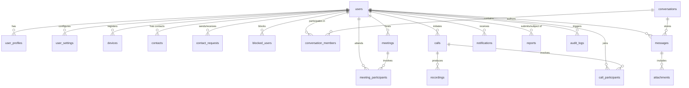

# VIYO Database Schema Specification

All tables utilize UUID primary keys, UTC timestamps (`created_at`, `updated_at`), foreign keys with cascade/restrict rules, and appropriate indexes for high-throughput queries.

---

## Entity Relationship Overview

---

## Table Definitions

### 1. `users`
- `id`: UUID (Primary Key, default `gen_random_uuid()`)
- `email`: VARCHAR(255) (Unique, Indexed, Not Null)
- `username`: VARCHAR(50) (Unique, Indexed, Not Null)
- `hashed_password`: VARCHAR(255) (Nullable for OAuth/Firebase users)
- `firebase_uid`: VARCHAR(128) (Unique, Nullable, Indexed)
- `is_active`: BOOLEAN (Default TRUE)
- `is_verified`: BOOLEAN (Default FALSE)
- `is_admin`: BOOLEAN (Default FALSE)
- `created_at`: TIMESTAMPTZ (Default NOW())
- `updated_at`: TIMESTAMPTZ (Default NOW())

### 2. `user_profiles`
- `id`: UUID (Primary Key)
- `user_id`: UUID (Foreign Key -> users.id ON DELETE CASCADE, Unique)
- `display_name`: VARCHAR(100) (Not Null)
- `avatar_url`: VARCHAR(512) (Nullable)
- `bio`: TEXT (Nullable)
- `status_message`: VARCHAR(140) (Nullable)
- `is_online`: BOOLEAN (Default FALSE, Indexed)
- `last_seen`: TIMESTAMPTZ (Nullable)
- `updated_at`: TIMESTAMPTZ (Default NOW())

### 3. `user_settings`
- `id`: UUID (Primary Key)
- `user_id`: UUID (Foreign Key -> users.id ON DELETE CASCADE, Unique)
- `privacy_last_seen`: VARCHAR(20) (Default 'contacts_only', Check: in ('everyone', 'contacts_only', 'nobody'))
- `privacy_calls`: VARCHAR(20) (Default 'everyone', Check: in ('everyone', 'contacts_only', 'nobody'))
- `privacy_profile_photo`: VARCHAR(20) (Default 'everyone')
- `allow_incoming_calls`: BOOLEAN (Default TRUE)
- `camera_enabled_by_default`: BOOLEAN (Default TRUE)
- `microphone_enabled_by_default`: BOOLEAN (Default TRUE)
- `push_notifications_enabled`: BOOLEAN (Default TRUE)
- `updated_at`: TIMESTAMPTZ (Default NOW())

### 4. `devices`
- `id`: UUID (Primary Key)
- `user_id`: UUID (Foreign Key -> users.id ON DELETE CASCADE)
- `fcm_token`: VARCHAR(512) (Nullable, Indexed)
- `device_type`: VARCHAR(20) (Not Null, Check: in ('android', 'web', 'ios'))
- `device_name`: VARCHAR(100) (Nullable)
- `last_active_at`: TIMESTAMPTZ (Default NOW())
- `created_at`: TIMESTAMPTZ (Default NOW())

### 5. `contacts`
- `id`: UUID (Primary Key)
- `user_id`: UUID (Foreign Key -> users.id ON DELETE CASCADE)
- `contact_user_id`: UUID (Foreign Key -> users.id ON DELETE CASCADE)
- `nickname`: VARCHAR(100) (Nullable)
- `created_at`: TIMESTAMPTZ (Default NOW())
- UNIQUE(user_id, contact_user_id)

### 6. `contact_requests`
- `id`: UUID (Primary Key)
- `sender_id`: UUID (Foreign Key -> users.id ON DELETE CASCADE)
- `receiver_id`: UUID (Foreign Key -> users.id ON DELETE CASCADE)
- `status`: VARCHAR(20) (Default 'pending', Check: in ('pending', 'accepted', 'rejected', 'cancelled'))
- `created_at`: TIMESTAMPTZ (Default NOW())
- `updated_at`: TIMESTAMPTZ (Default NOW())

### 7. `blocked_users`
- `id`: UUID (Primary Key)
- `blocker_id`: UUID (Foreign Key -> users.id ON DELETE CASCADE)
- `blocked_id`: UUID (Foreign Key -> users.id ON DELETE CASCADE)
- `reason`: TEXT (Nullable)
- `created_at`: TIMESTAMPTZ (Default NOW())
- UNIQUE(blocker_id, blocked_id)

### 8. `conversations`
- `id`: UUID (Primary Key)
- `type`: VARCHAR(20) (Not Null, Check: in ('direct', 'group'))
- `title`: VARCHAR(150) (Nullable for direct)
- `avatar_url`: VARCHAR(512) (Nullable)
- `created_by`: UUID (Foreign Key -> users.id ON DELETE SET NULL)
- `created_at`: TIMESTAMPTZ (Default NOW())
- `updated_at`: TIMESTAMPTZ (Default NOW())

### 9. `conversation_members`
- `id`: UUID (Primary Key)
- `conversation_id`: UUID (Foreign Key -> conversations.id ON DELETE CASCADE)
- `user_id`: UUID (Foreign Key -> users.id ON DELETE CASCADE)
- `role`: VARCHAR(20) (Default 'member', Check: in ('owner', 'admin', 'member'))
- `joined_at`: TIMESTAMPTZ (Default NOW())
- `last_read_message_id`: UUID (Nullable)
- UNIQUE(conversation_id, user_id)

### 10. `messages`
- `id`: UUID (Primary Key)
- `conversation_id`: UUID (Foreign Key -> conversations.id ON DELETE CASCADE, Indexed)
- `sender_id`: UUID (Foreign Key -> users.id ON DELETE SET NULL, Indexed)
- `content`: TEXT (Nullable)
- `message_type`: VARCHAR(20) (Default 'text', Check: in ('text', 'image', 'audio', 'system'))
- `is_deleted`: BOOLEAN (Default FALSE)
- `created_at`: TIMESTAMPTZ (Default NOW(), Indexed)
- `updated_at`: TIMESTAMPTZ (Default NOW())

### 11. `attachments`
- `id`: UUID (Primary Key)
- `message_id`: UUID (Foreign Key -> messages.id ON DELETE CASCADE, Indexed)
- `file_url`: VARCHAR(512) (Not Null)
- `file_name`: VARCHAR(255) (Not Null)
- `file_size_bytes`: BIGINT (Not Null)
- `mime_type`: VARCHAR(100) (Not Null)
- `duration_seconds`: INTEGER (Nullable for voice/audio)
- `created_at`: TIMESTAMPTZ (Default NOW())

### 12. `calls`
- `id`: UUID (Primary Key)
- `caller_id`: UUID (Foreign Key -> users.id ON DELETE SET NULL, Indexed)
- `receiver_id`: UUID (Foreign Key -> users.id ON DELETE SET NULL, Indexed, Nullable for group)
- `room_name`: VARCHAR(100) (Unique, Not Null)
- `call_type`: VARCHAR(20) (Not Null, Check: in ('video', 'voice', 'group'))
- `status`: VARCHAR(20) (Default 'initiated', Check: in ('initiated', 'ringing', 'accepted', 'rejected', 'ended', 'missed', 'busy'))
- `started_at`: TIMESTAMPTZ (Nullable)
- `ended_at`: TIMESTAMPTZ (Nullable)
- `duration_seconds`: INTEGER (Default 0)
- `created_at`: TIMESTAMPTZ (Default NOW())

### 13. `call_participants`
- `id`: UUID (Primary Key)
- `call_id`: UUID (Foreign Key -> calls.id ON DELETE CASCADE, Indexed)
- `user_id`: UUID (Foreign Key -> users.id ON DELETE CASCADE, Indexed)
- `joined_at`: TIMESTAMPTZ (Default NOW())
- `left_at`: TIMESTAMPTZ (Nullable)
- `role`: VARCHAR(20) (Default 'participant')
- `connection_status`: VARCHAR(20) (Default 'connected')

### 14. `meetings`
- `id`: UUID (Primary Key)
- `meeting_code`: VARCHAR(20) (Unique, Indexed, Not Null)
- `host_id`: UUID (Foreign Key -> users.id ON DELETE CASCADE, Indexed)
- `title`: VARCHAR(150) (Not Null)
- `room_name`: VARCHAR(100) (Unique, Not Null)
- `is_active`: BOOLEAN (Default TRUE)
- `waiting_room_enabled`: BOOLEAN (Default FALSE)
- `created_at`: TIMESTAMPTZ (Default NOW())
- `ended_at`: TIMESTAMPTZ (Nullable)

### 15. `meeting_participants`
- `id`: UUID (Primary Key)
- `meeting_id`: UUID (Foreign Key -> meetings.id ON DELETE CASCADE, Indexed)
- `user_id`: UUID (Foreign Key -> users.id ON DELETE CASCADE)
- `is_admitted`: BOOLEAN (Default TRUE)
- `joined_at`: TIMESTAMPTZ (Default NOW())
- `left_at`: TIMESTAMPTZ (Nullable)

### 16. `notifications`
- `id`: UUID (Primary Key)
- `user_id`: UUID (Foreign Key -> users.id ON DELETE CASCADE, Indexed)
- `type`: VARCHAR(50) (Not Null)
- `title`: VARCHAR(150) (Not Null)
- `body`: TEXT (Not Null)
- `payload_json`: JSONB (Nullable)
- `is_read`: BOOLEAN (Default FALSE)
- `created_at`: TIMESTAMPTZ (Default NOW())

### 17. `recordings`
- `id`: UUID (Primary Key)
- `call_id`: UUID (Foreign Key -> calls.id ON DELETE SET NULL, Nullable)
- `meeting_id`: UUID (Foreign Key -> meetings.id ON DELETE SET NULL, Nullable)
- `file_url`: VARCHAR(512) (Not Null)
- `duration_seconds`: INTEGER (Default 0)
- `status`: VARCHAR(20) (Default 'completed')
- `created_at`: TIMESTAMPTZ (Default NOW())

### 18. `reports`
- `id`: UUID (Primary Key)
- `reporter_id`: UUID (Foreign Key -> users.id ON DELETE CASCADE)
- `reported_user_id`: UUID (Foreign Key -> users.id ON DELETE CASCADE)
- `reason`: VARCHAR(100) (Not Null)
- `description`: TEXT (Nullable)
- `status`: VARCHAR(20) (Default 'pending', Check: in ('pending', 'investigating', 'resolved', 'dismissed'))
- `created_at`: TIMESTAMPTZ (Default NOW())

### 19. `audit_logs`
- `id`: UUID (Primary Key)
- `user_id`: UUID (Foreign Key -> users.id ON DELETE SET NULL, Nullable)
- `action`: VARCHAR(100) (Not Null, Indexed)
- `resource_type`: VARCHAR(50) (Not Null)
- `resource_id`: VARCHAR(100) (Nullable)
- `ip_address`: VARCHAR(45) (Nullable)
- `user_agent`: VARCHAR(255) (Nullable)
- `metadata_json`: JSONB (Nullable)
- `created_at`: TIMESTAMPTZ (Default NOW())

